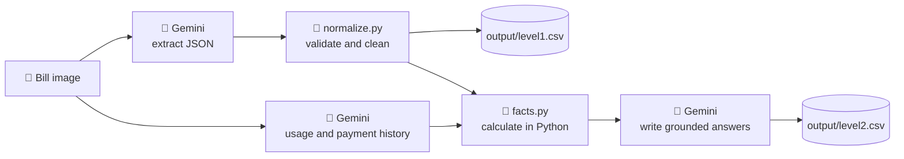

<div align="center">

# 🧾 Utility Bill Decoder

### Turn messy electricity bills into clear answers, built with AI


**Upload a K-Electric, LESCO or IESCO bill. Get the details as structured data, and plain-English answers to real questions.**

[What it does](#-what-it-does) · [How it works](#-how-it-works) · [Quick start](#-quick-start) · [Project structure](#-project-structure) · [AI usage](#-ai-usage)

</div>

---

## 💡 The problem

Electricity bills mix tariff slabs, fuel adjustments, taxes, arrears and late-payment charges, and every provider lays them out differently. Most people can't tell whether they are being charged correctly, or what next month will cost.

## ✨ What it does

| Level | Task | Output |
|:--:|---|---|
| 🟦 **1** | **Extraction.** Reads the bill image and returns its key details, with personal identifiers removed. | One JSON object per bill |
| 🟩 **2** | **Explanation.** Answers 12 customer questions per bill, such as *"How much of my bill is taxes?"* and *"How many units should I expect next month?"* | One grounded English answer per question |

<details>
<summary><b>🔍 Example: what Level 1 extracts (click to expand)</b></summary>

```json
{
  "provider": "KE",
  "tariff": "A1-R",
  "bill_month": "2026-04",
  "units_consumed": 151,
  "total_taxes": 569.62,
  "current_bill": 3430.24,
  "payable_within_due_date": 3430,
  "payable_after_due_date": 3716
}
```

The full schema has charges, taxes, readings, dates and arrears. Every value is taken from the bill as printed, with no recalculation.

</details>

<details>
<summary><b>💬 Example: what Level 2 answers (click to expand)</b></summary>

> **Q: How much of my bill is taxes?**
> Taxes and duties total PKR 569.62 out of your current bill of PKR 3,430.24, or about 16.6%.

> **Q: Which months in my history went above 200 units?**
> *(Answer comes from the usage chart. The figures are calculated in code, not estimated by the model.)*

</details>

---

## 🧠 How it works



**The design choice that matters:** the model reads and explains, but it never does the arithmetic. Averages, percentages, trends and estimates are calculated in plain Python and handed to the model as verified facts. This keeps the numbers correct.

<details>
<summary><b>🧩 Key design decisions</b></summary>

- **Strict JSON output.** Temperature is 0, and every reply is parsed and validated against the schema.
- **Safe defaults.** A value that isn't printed, or is unreadable, becomes `null`. The system never guesses.
- **Grounded answers.** The model may only use bill data and calculated facts. Estimates are labelled, and missing data is stated plainly.
- **Cost-aware.** Results are cached, so a rerun doesn't repeat paid calls.
- **Official vs preview.** Test runs write `level1.csv`. Training runs write a separate preview file, so the official output is never overwritten.

</details>

---

## 🚀 Quick start

> Requires **Python 3.13** (3.11+ works), Windows PowerShell shown, and a free **Gemini API key** from [Google AI Studio](https://aistudio.google.com).

<details open>
<summary><b>① Set up</b></summary>

Run everything from the `source/` folder:

```powershell
python -m venv .venv
.venv\Scripts\activate
pip install -r requirements.txt
```

Create `source/.env` (copy `.env.example`) and add your key:

```env
MODEL_PROVIDER=google
MODEL_NAME=gemini-3.1-flash-lite
API_KEY=your-api-key-here
```

> 🔒 Never commit `.env`. It is excluded by `.gitignore`.

Place the test bills in `source/data/test/bills/`.

</details>

<details open>
<summary><b>② Run the pipeline</b></summary>

```powershell
python test_gemini.py          # ✅ checks the key and model (expect "ready" and 151)
python run_level1.py --test    # 🧾 writes ../output/level1.csv
python run_level2.py           # 💬 writes ../output/level2.csv
```

Optional preview on the training bills (writes `level1_train_preview.csv`, never overwrites the official file):

```powershell
python run_level1.py --train
```

</details>

<details>
<summary><b>③ Results and troubleshooting</b></summary>

| Output | Contents | Expected |
|---|---|---|
| `output/level1.csv` | `bill_id, json` | 10 rows |
| `output/level2.csv` | `bill_id, question_id, question, answer` | 120 answers |

- **Re-run from scratch:** delete `output/*.csv` and `source/cache/`.
- **A run stalls:** requests time out after 60 seconds. Check your internet connection and try again.
- **Rate limit errors:** the free tier allows about 15 requests per minute. Wait a minute and re-run. Finished bills are cached, so you won't lose progress.

</details>

---

## 🗂️ Project structure

```text
utility-bill-decoder/
├── output/
│   ├── level1.csv              🧾 extracted JSON per bill
│   └── level2.csv              💬 120 answers
└── source/
    ├── run_level1.py           Level 1 pipeline
    ├── run_level2.py           Level 2 pipeline
    ├── level2_history.py       usage chart and payment history extraction
    ├── facts.py                calculations done in Python
    ├── prompts.py              all model instructions
    ├── normalize.py            cleans and validates model output
    ├── llm.py                  single Gemini client with retries
    ├── config.py               settings loaded from .env
    ├── test_gemini.py          key and model check
    ├── requirements.txt        pinned dependencies
    └── data/test/              test bills and CSV templates
```

---

## 🤖 AI usage

| Category | What was used |
|---|---|
| **Models** | Google Gemini `gemini-3.1-flash-lite`, for extraction, history reading and answer writing |
| **APIs and services** | Google AI Studio Gemini API via the `google-genai` SDK |
| **Invoice or receipt extraction services** | None |
| **Local OCR libraries** | None |
| **AI coding tools** | Claude (Anthropic), used to help draft the code and this README. All code was reviewed and run by the author. |

---

## ⚠️ Limitations

- Answers are only as good as the bill's legibility. A blurred or cropped chart produces "not shown on the bill" rather than a guess.
- The FPA question refers to the current month, since the bill shows one month's FPA line.
- "Expected next month" and "monthly set-aside" figures are labelled estimates.

---

<div align="center">

**Built with AI for the 10Pearls Hackathon** 🏆

*Clear bills. Clear answers.*

</div>
